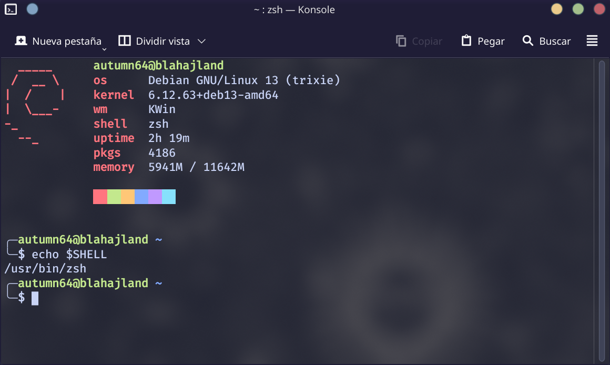
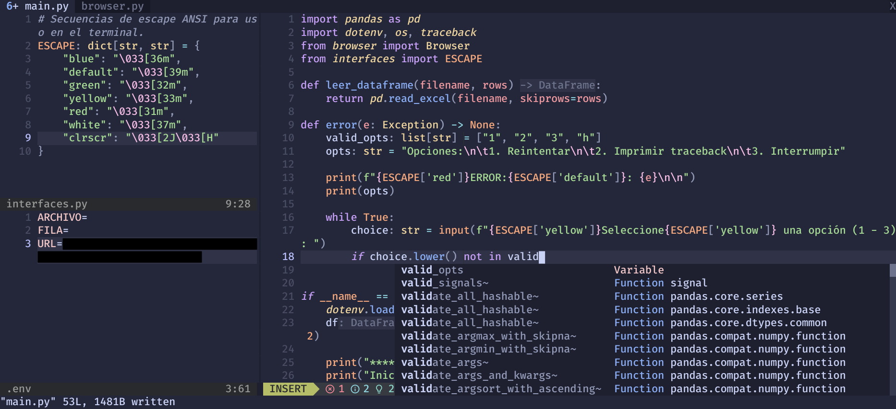
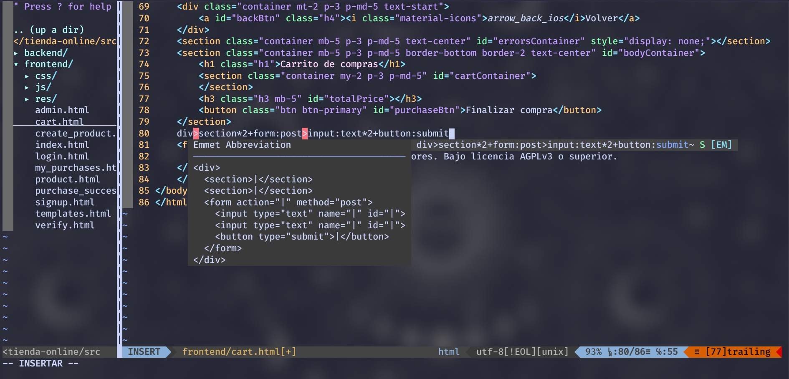

# Dotfiles

## Introduction

These are my dotfiles for the very few terminal tools I actually customize. This customization is not very deep and is still not automated.

These dotfiles should work on any GNU/Linux distribution (and maybe even on macOS, BSD and any Unix[-like] operating system) as long as all the requirements are successfully met. Also, they have comments so that I and other people can understand what's going on, but be aware that everything is in Spanish.

Even so, everyone is free to copy and modify my dotfiles for any purpose. Be aware that, since there's currently no way to install these dotfiles automatically, you'll have to set them up by yourself and at your own risk.

Credit is not necessary though appreciated!

## Requirements

- General requirements:
    * Either [cURL](https://github.com/curl/curl) or [GNU Wget](https://www.gnu.org/software/wget/).
    * [FiraCode](https://github.com/tonsky/FiraCode).
    * FiraCode's [nerdfont](https://www.nerdfonts.com/).
    * [git](https://git-scm.com/).
    * [Node.js](https://nodejs.org) and [npm](https://docs.npmjs.com/downloading-and-installing-node-js-and-npm).
    * [Powerline fonts](https://github.com/powerline/fonts).
- Konsole:
    * [Zsh](https://wiki.archlinux.org/title/Zsh).
- Neovim: 
    * Must be version `>= 0.11.3`.
- Vim: 
    * Must be version `>= 9.0.0438`.
    * [vim-plug](https://github.com/junegunn/vim-plug).
- Zsh: 
    * [oh-my-zsh](https://github.com/ohmyzsh/ohmyzsh).
    * [pfetch](https://github.com/dylanaraps/pfetch).

## Screenshots

### Konsole + Zsh

### Neovim

### Vim

## Author

|  |
|---|
| [Mónica Gómez (Autumn64)](https://www.autumn64.xyz) |
